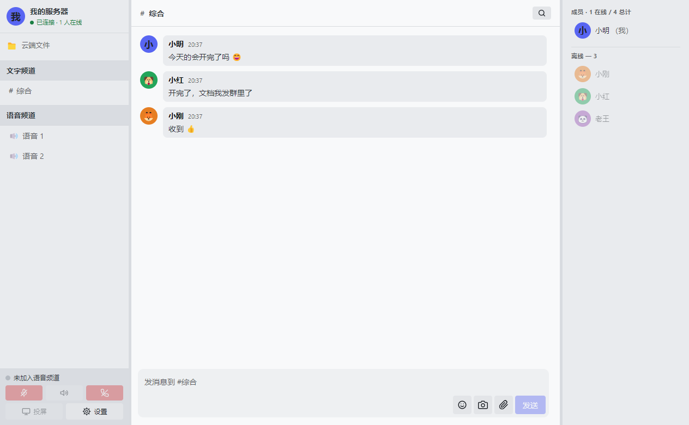
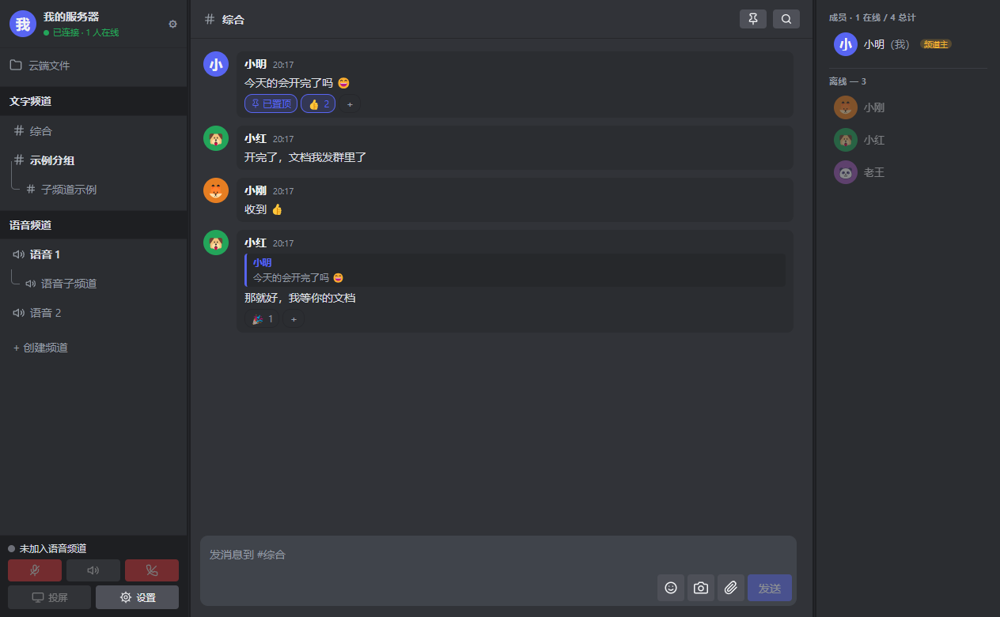
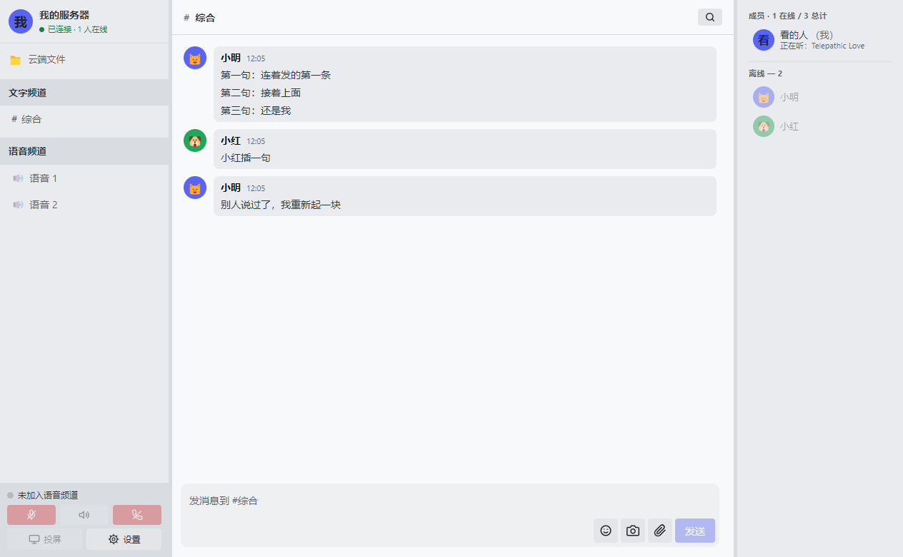
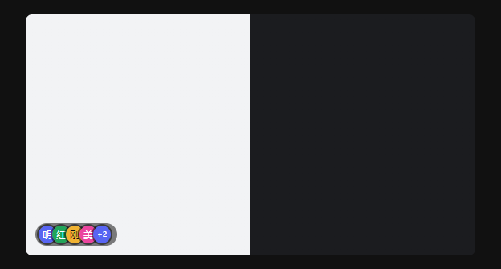
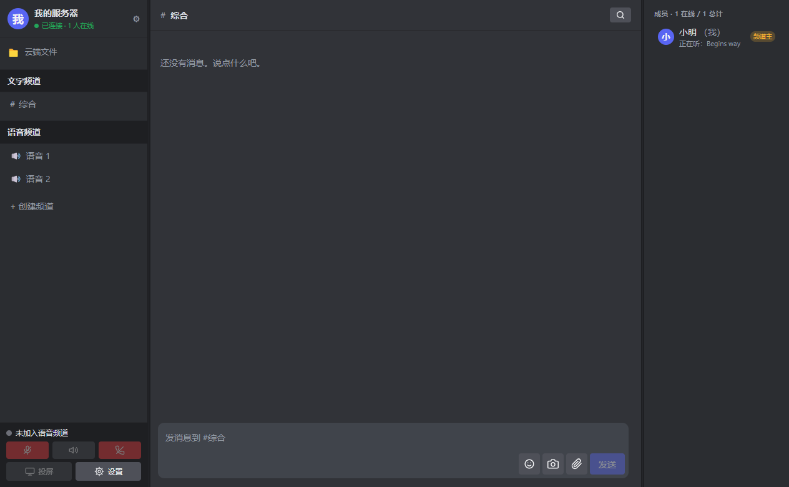

# Voice

自建的语音 + 文字 + 投屏客户端与服务端 —— 为**几个人的小圈子**写的私服，类似自建 Discord。

---

## ⚠️ 先说清楚：**这个项目是 AI 写的**

> **代码和文档绝大部分由 AI（DeepSeek）生成** ✓
> 人类做的是：提需求、定技术选型、实际部署、发现 bug、验收 ✓
>
> **不是"AI 辅助"** ✗ —— 是 **AI 主写** ✓ 人**驱动和审阅** ✓
> 从服务端到客户端到部署脚本到这份 README ✓ 都是这么来的 ✓

**它经过的验证** ✓

- **200 多条测试断言**，覆盖身份、权限、活动状态、文件、消息分组、投屏档位等 ✓
- **真的部署在一台云服务器上** ✓ **真的有一小圈人在日常用** ✓
- 每一个 bug 的排查过程都记在 [`voice-client/CHANGELOG.md`](voice-client/CHANGELOG.md) 里 ✓
  （包括**判断错的方向**和**改错又改回来的地方** ✗）

**它没经过的验证** ✗

- **没有专业安全审计** ✗ —— 没有渗透测试、没有代码审计、没有依赖漏洞扫描 ✓
- **没有大规模并发验证** ✗ —— 设计目标是**几个人**，不是几百人 ✓
- **没有跨平台验证** ✗ —— 客户端目前只在 **Windows** 上真跑过 ✓

**所以**：自己几个人的小圈子用 ✓ 完全够 ✓
想对外提供服务、或者拿去做别的事 ✓ **请自己审一遍代码再决定** ✓
不要因为"它能跑起来"就默认它是安全的 ✗

---

> ⚠️ 这个仓库是**通用模板** ✓ 里面的服务器地址和邀请码都是**占位符** ✗
> 部署时按下面的说明换成你自己的 ✓

## 组成

| 目录 | 是什么 |
|---|---|
| `voice-server/` | 服务端：Node 24 + Fastify + `node:sqlite`（**零原生依赖**）+ LiveKit（单文件二进制，**不用 Docker**） |
| `voice-client/` | 桌面客户端：Electron 33 + React 19，Windows 为主，支持自动更新 |

## 功能

- **语音频道** —— 麦克风处理开关（降噪/回声消除/自动增益）· 独立音量 · 进出铃声
- **文字频道 / 私聊** —— 附件、截图、云端文件、搜索
- **投屏** —— 720p30 到 2K60 **七档**可调（含一档 2.5 Mbps 省流档，给 6 Mbps 出口的服务器用）· 独立音量 · 观看者头像
- **状态** —— 「正在听」（Windows SMTC）·「正在玩」（进程 + 可共享的白名单）
- **权限** —— 频道主 / 管理员 / 成员

## 界面

| 浅色 | 深色 |
|---|---|
|  |  |

左边是频道列表（文字频道 / 语音频道 / 云端文件），**左下角是语音面板**
（状态行 + 麦克风 / 喇叭 / 关喇叭 + 投屏 / 设置）。中间是聊天，右边是成员列表。

> ⚠️ **语音面板在左下角，不是横在底部** ✗
> 它原来横跨整个中间区域，把聊天和投屏**各挤掉了一行** ✓
> 挪进左栏之后，中间就只剩聊天和投屏这两件事了 ✓
> （代码里 `App.tsx` 和 `styles.css` 都记了这段原因 ✓）

**连续消息会合并成一个气泡** —— 头像和昵称只出现在第一条上。
同一个人的消息只要间隔在 5 分钟内、中间没人插话，就算一组。



**投屏时观看者的头像是叠起来显示的**，鼠标移上去自动展开。



**「正在听」** 会显示对方正在听什么（Windows 走 SMTC）。



## 快速开始

部署看 **[voice-server/开始操作.md](voice-server/开始操作.md)** ——
从一台空服务器到跑起来，包括所有实际踩过的坑。

改代码之前先读 **[voice-client/CHANGELOG.md](voice-client/CHANGELOG.md)** ——
那里记了每个技术决策**为什么**这么做、以及踩过什么坑。

## 几个值得一说的设计

- **服务端零原生依赖** —— 用 Node 24 自带的 `node:sqlite` ✗
  不用 `better-sqlite3` ✓ 因为后者要下载预编译二进制（走 GitHub ✓ 国内经常失败 ✗）
- **身份由客户端生成** —— 不能让服务端下发 ✗
  否则 React StrictMode 会把 effect 跑两遍 ✓ 造出两个身份 ✓ 频道主锁死在一个回不来的身份上 ✗
- **投屏的 `contentHint` 比码率更重要** —— 屏幕内容是锐利文字 ✓
  编码器要优先保边缘 ✓ 选错会让帧率一直被压 ✓ 看着就是"卡"
- **`.cmd` 必须纯 ASCII**、**`.ps1` 必须带 BOM**、**`.yaml` 绝不能有 BOM** ✗
  三条互相矛盾的规则 ✓ 仓库里有护栏脚本自动检查 ✓
- **投屏分享的是「游戏 / 音乐」，不含频道里的说话声** ——
  系统的桌面回环录的是**默认输出设备上的一切** ✗ 包括我们自己正在播的通话声 ✗
  那样对方就会听到自己的回声 ✓ 根本不能用 ✓
  所以这里用的是 Windows 的**进程级回环**（WASAPI ProcessLoopback ✓）：

  ```
  系统混音（游戏 + 音乐 + 通话声）
    −  本软件的进程树（通话声就是从这儿放出来的）
    ─────────────────────────────────
    =  游戏 + 音乐
  ```

  ★ 通话声是**物理上没进过采集链路** ✓ **不是事后过滤** ✓ 所以**零音质损失** ✓
  验证用的是**两个互不成谐波的纯音**（440Hz 普通进程 / 1500Hz 本程序 ✓）：
  同一测量、只改一个开关 ✓ 1500Hz 掉了 **126 dB** ✓

  > ⚠️ 顺带一个教训：**「链路通」和「采到了声音」是两回事** ✗
  > 第一次测试收到 198 块、190080 采样、完整度 99%，看着完全正常 ——
  > **峰值只有 11/32767，也就是静音** ✓ 所以测试里加了 `peak < 50` 的硬警告 ✓

  （**只有 Windows 提供这个能力** ✗ —— Linux 上会退回整系统捕获 ✓
  也就是"投屏有画面、没声音"，免得把通话声录进去 ✓）

## 部署到自己的服务器

1. 把 `voice-client/src/renderer/src/lib/config.ts` 里的 `YOUR_SERVER_IP`
   换成你的地址（**两个端口也要按你的实际情况改**）
2. 把 `voice-server/livekit/livekit.yaml` 的 `node_ip` 换成你的公网 IP
3. 按 `voice-server/开始操作.md` 走一遍
4. 自己设一个邀请码，填进 `.env` 和服务端

## 许可

见 [LICENSE](LICENSE)。